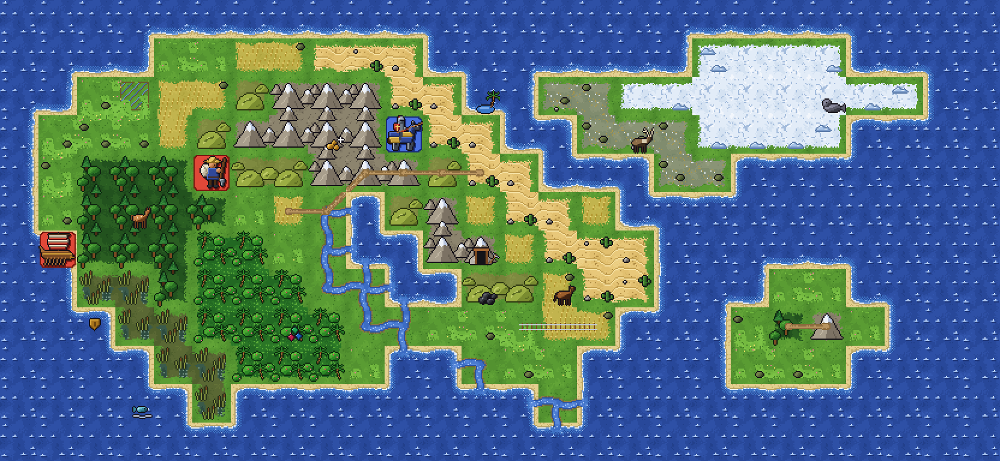
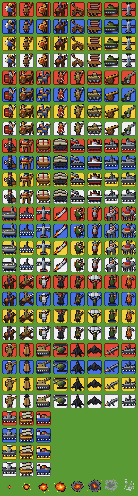
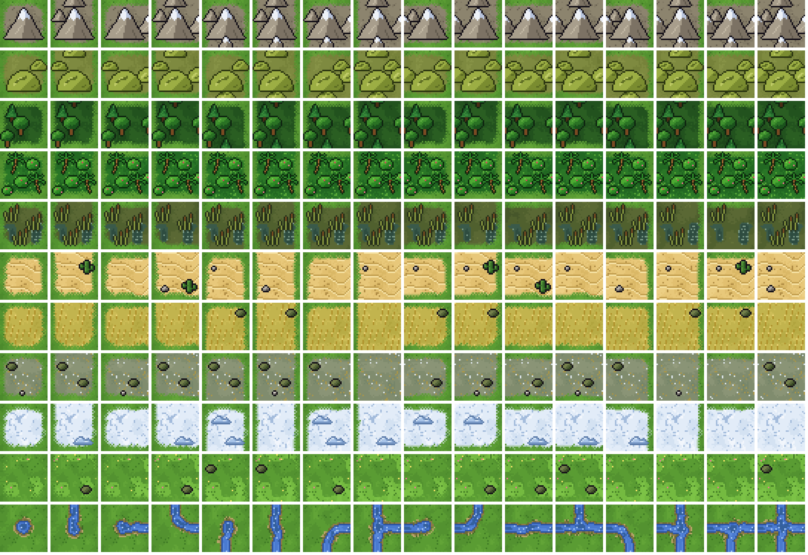
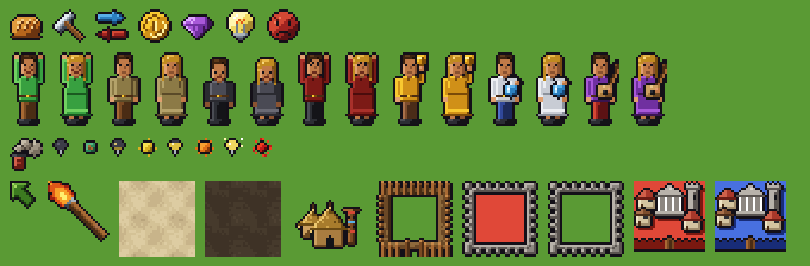
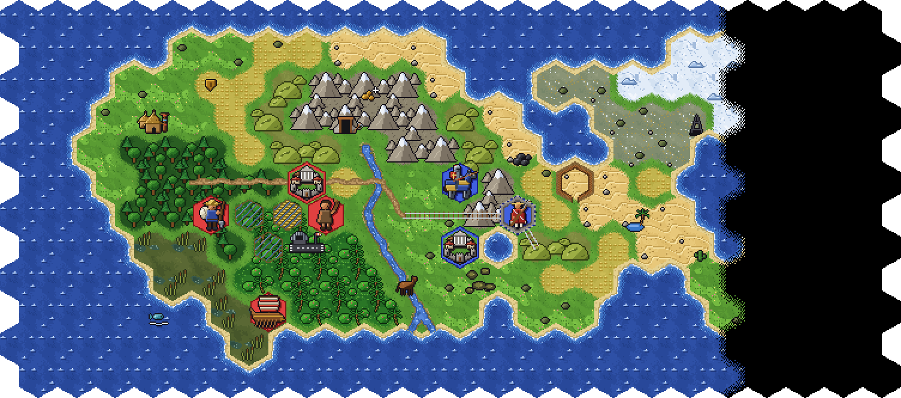

# civ1-tileset-pixelart

An original, royalty-free pixel-art tileset for [civ.one](https://civ.one): every sprite its Civ1 rules need
(units, terrain, cities, improvements and interface icons) at 32px, with the feel of the early-90s classics and none
of their art. It comes in two packs: one for the square grid, and one for the hexagonal grid
([below](#the-hexagonal-pack)).



## Clean room

No sprite is traced, sampled, upscaled or converted from another game. Each one is drawn by code in `src/` from the
written descriptions in [SPEC.md](SPEC.md), and whoever wrote that code worked from the spec and the pack's own renders
only. The code is the record of how every pixel was made: build it and you get the committed sprites exactly (CI
checks that).

Only the sprite names come from civ.one's existing tileset format, so the pack fits the renderer as it is. Interface
icons, citizens and cursors are drawn at the size the renderer shows them (`ui` in `tileset.json`), not enlarged from
smaller originals.

## What's in it

- 28 units on a badge in the player's colour, and 8 combat frames.
- 11 terrains, each with all 16 ways of joining its neighbours. Mountain ranges, hills, forests and jungle run on from
  tile to tile, and edges against other terrain are ragged rather than square.
- Coast, rivers and river mouths, 11 specials, roads, railroads, irrigation, mines, pollution and fog.
- The city, hut, fort and fortified overlay (also drawn over a walled city), citizens, interface icons and cursors.







## The hexagonal pack

The same style on civ.one's hexagonal grid: pointy-topped hexes in a 32 × 36 box, in rows 27px apart, odd rows
shifted half a hex. What has the shape of a tile is drawn again for a hexagon, from [SPEC-HEX.md](SPEC-HEX.md):

- terrain, with all 64 ways of joining its six neighbours, and features that run on into a joined neighbour;
- the coast in six wedges, rivers and river mouths;
- roads and railroads in six directions, irrigation, fog, the fort and the fortified wall (also a walled city's);
- the city with a rim in its owner's colours;
- units on a hexagonal badge.

The interface's sprites, and the figures on the units and specials, are the square pack's own.



## Layout

| Path | What |
| --- | --- |
| `tileset.json` | The tileset descriptor civ.one reads (id `civ1-pixelart`) |
| `pack/` | The built sprites, one PNG per sprite name, and a copy of `tileset.json` |
| `tileset-hex.json`, `pack-hex/` | The hexagonal pack's descriptor (id `hex-pixelart`) and its built sprites |
| `src/lib.js` | Drawing primitives (shaded ellipses, bevels, outlines) and a PNG writer |
| `src/units.js`, `src/combat.js` | Units and combat frames |
| `src/terrain.js` | Land, ocean, terrain joins, coast, rivers, specials, improvements and fog |
| `src/misc.js` | Interface icons, citizens, cursors, textures, city, hut, fort |
| `src/hex.js`, `src/hex-map.js` | The hexagonal pack: geometry, terrain, joins, coast and rivers; then everything else |
| `tools/` | Preview sheets |

## Building

Node 18 or later, no dependencies:

```bash
npm run build
```

```bash
npm run previews
```

`npm run check` fails unless the committed packs are what the code draws. It compares pixels, not bytes, as PNG
compression changes with the zlib Node ships. It also checks the hexagonal pack's geometry:

- its tiles, put down in odd-r rows, cover every pixel exactly once;
- every sprite drawn on the map's tiles keeps to its own tile's pixels, and the city to the inside of its rim;
- its patterns repeat on the lattice, and the dither and glints keep to their own 4 × 3 periods and cells.

## Licence

MIT, code and sprites alike: see [LICENSE](LICENSE).
