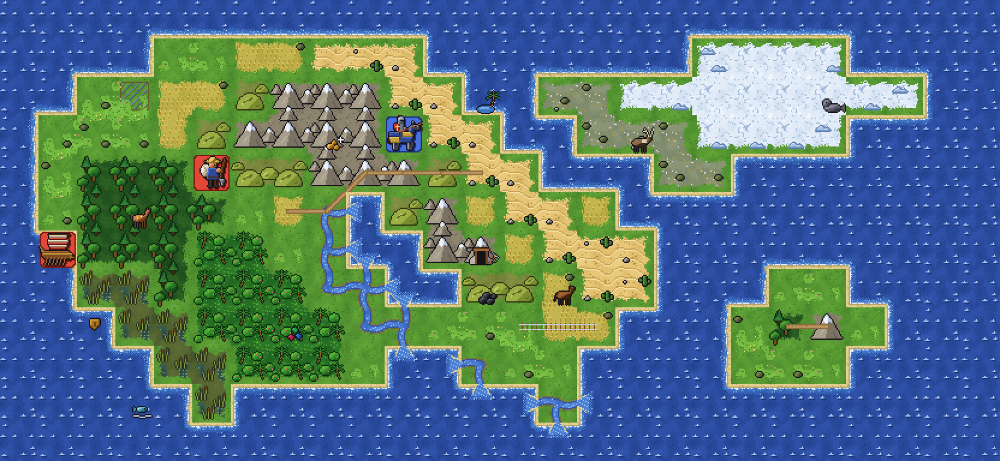
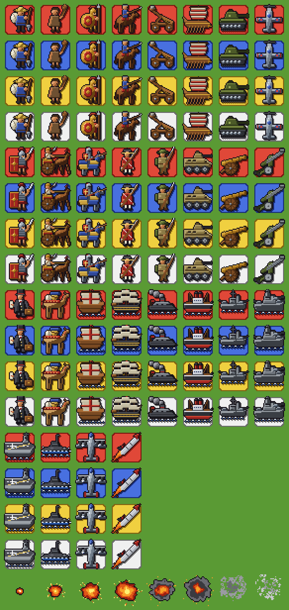
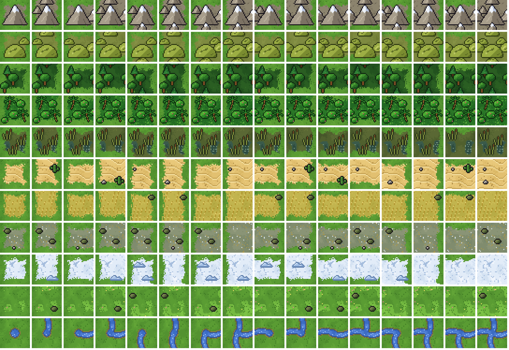
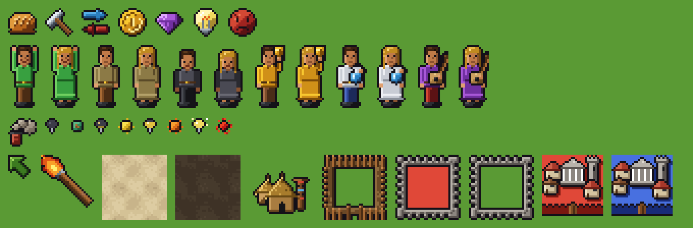

# civ1-tileset-pixelart

An original, royalty-free pixel-art tileset for [civ.one](https://civ.one): every sprite its Civ1 rules need
(units, terrain, cities, improvements and interface icons) at 32px, with the feel of the early-90s classics and none
of their art.



## Clean room

No sprite is traced, sampled, upscaled or converted from another game. Each one is drawn by code in `src/` from the
written descriptions in [SPEC.md](SPEC.md), and whoever wrote that code worked from the spec and the pack's own renders
only. The code is the record of how every pixel was made: build it and you get the committed sprites exactly (CI
checks that).

Only the sprite names and sizes come from civ.one's existing tileset format, so the pack fits the renderer as it is.

## What's in it

- 28 units on a badge in the player's colour, and 8 combat frames.
- 11 terrains, each with all 16 ways of joining its neighbours. Mountain ranges, hills, forests and jungle run on from
  tile to tile, and edges against other terrain are ragged rather than square.
- Coast, rivers and river mouths, 11 specials, roads, railroads, irrigation, mines, pollution and fog.
- The city, hut, fort and fortified overlay, citizens, interface icons and cursors.







## Layout

| Path | What |
| --- | --- |
| `tileset.json` | The tileset descriptor civ.one reads (id `civ1-pixelart`) |
| `pack/` | The built sprites, one PNG per sprite name, and a copy of `tileset.json` |
| `src/lib.js` | Drawing primitives (shaded ellipses, bevels, outlines) and a PNG writer |
| `src/units.js`, `src/combat.js` | Units and combat frames |
| `src/terrain.js` | Land, ocean, terrain joins, coast, rivers, specials, improvements and fog |
| `src/misc.js` | Interface icons, citizens, cursors, textures, city, hut, fort |
| `tools/` | Preview sheets |

## Building

Node 18 or later, no dependencies:

```bash
npm run build
```

```bash
npm run previews
```

`npm run check` fails unless the committed pack is what the code draws. It compares pixels, not bytes, as PNG
compression changes with the zlib Node ships.

## Licence

MIT, code and sprites alike: see [LICENSE](LICENSE).
